<p align="center">
  <a href="https://portfolio-one-rouge-50.vercel.app/"></a>
  <a href="https://wakatime.com/@9566c98e-0942-41bf-951a-6b7651fed032"></a>
  
</p>

### 김효제

울산대 ICT융합학부 1학년입니다.
귀찮은 일이 생기면 자동화부터 해보고, 대회 공고가 보이면 일단 신청부터 합니다.
올해는 그렇게 열 번 넘게 나갔고, 그중 몇 번은 상을 받았습니다.

<br/>

### Awards

| 대회 | 주최 | 결과 |
|---|---|:-:|
| **2026 울산 게임 콘텐츠 개발 해커톤** <br/><sub>팀 RE:제로 / 맵·레벨 디자인, 스테이지·카드 설계 / [기사](https://www.ujnews.co.kr/news/newsview.php?ncode=1065587850204696)</sub> | 울산정보산업진흥원 | **대상** |
| **신입생 연구체험 프로그램** <br/><sub>Siemens 기반 공정 효율 개선</sub> | 울산대 ICT융합학부 | **최우수상** |
| **2026 디지털 콘텐츠 창작 공모전** <br/><sub>웹사이트와 시스템 프롬프트로 AI 제작</sub> | 울산대 교수학습개발팀 | **우수상** |
| **UOU 로봇OS 특강 + 피지컬AI 챌린지** <br/><sub>로봇의 물체 이동 효율 최적화</sub> | SW중심대학(울산대) | **3등** |

<br/>

### 2026  대학교 1학년

```
* 11.03  deploy   포트폴리오 사이트
* 11.02  feat     three.js로 3D 사격 게임. 봇 AI까지 직접 짰다
* 10.30  lead     대구·울산·경북 X Upstage AI Agent Hackathon V.2 팀장
* 09.30  award    신입생 연구체험 프로그램 최우수상
* 09.10  release  mealpick. 8명이 같이 만든 동아리 서비스, 프론트 담당
* 08.31  award    디지털 콘텐츠 창작 공모전 우수상
* 08.22  try      CCE 사이버공격방어대회. 혼자 나가서 구경하다 몇 문제 찔러봄
* 08.21  award    울산 게임 콘텐츠 개발 해커톤 대상. 맵이랑 레벨 맡음
* 08.10  feat     SW-ICT-notice. 학과 공지 확인하기 귀찮아서 만든 봇
* 08.10  done     로컬 AI 메이커스랩 x 현대해상  6주
* 07.10  lead     부·울·경 AI융합해커톤 PM
* 05.30  award    피지컬AI 챌린지 3등
* 05.29  try      첫 프로그래밍 경진대회. 
* 01.06  init     problem-solving
```

<br/>

### 대학교 1학년 만든 것들

| 프로젝트 | 한 줄 | stack | 상태 |
|---|---|---|:-:|
| [**SW-ICT-notice**](https://github.com/KIMHYOJE/SW-ICT-notice) | 학과 공지 확인하기 귀찮아서, Actions가 대신 읽고 디스코드로 알려줌 | `python` `aws` `actions` | 운영 중 |
| [**사격 게임 3D**](https://gamegun.vercel.app/) | 이동, 사격, 명중 판정, 점수, 봇 AI까지 브라우저에서 | `next.js` `three.js` | 운영 중 |
| [**mealpick**](https://www.mealpick.store) | 동아리 공식 프로젝트, 8명 중 프론트 담당 | `frontend` | 운영 중 |
| [**Local AI Makers Lab**](https://github.com/KIMHYOJE/2026local-ai-makers-lab-hyundai2) | 현대해상 상품개발팀 문제를 듣고 AI와 사이트로 풀어봄 | `ai` `web` | 완료 |
| **SeaClean Priority AI** | 부·울·경 AI융합해커톤, PM으로 팀을 이끔 | `ai` | 완료 |
| [**problem-solving**](https://github.com/KIMHYOJE/problem-solving) | 백준, 프로그래머스, SWEA 풀이 기록 | `c` `c++` `python` | 진행 중 |
| [**portfolio**](https://portfolio-one-rouge-50.vercel.app/) | 개인 포트폴리오 | `node.js` | 운영 중 |

<p align="center">
  <a href="https://github.com/KIMHYOJE/SW-ICT-notice"></a>
  <a href="https://github.com/KIMHYOJE/problem-solving"></a>
</p>


<summary><b>그 외 참가한 것들</b></summary>
<br/>

| 시기 | 활동 | 역할 |
|---|---|---|
| 2026.05 | 2026-1학기 프로그래밍 경진대회 | 개인 |
| 2026.06 | 제1회 AI 활용 사회문제해결 아이디어 공모전 | 개인 |
| 2026.06 ~ 08 | 로컬 AI 메이커스랩 (코멘토 x 현대해상)  | 팀원 |
| 2026.07 | 제11회 부·울·경 AI융합해커톤 | **PM** |
| 2026.08 | 사이버공격방어대회 CCE (국가정보원) | 팀장 |
| 2026.10 | 2026-2학기 프로그래밍 경진대회 | 개인 |
| 2026.10 ~ 11 | K-MOOC 기개발 모니터링단 | 개인 |
| 2026.10 ~ 11 | 대구·울산·경북 X Upstage AI Agent Hackathon V.2 | **팀장** |
| 2026.10 ~ 11 | 카카오 AI_TOP_100 | 개인 |


<br/>

### 요즘

- 팀장으로 AI Agent 해커톤 준비 중 (~11.13)
- 카카오 AI_TOP_100 챗봇 만드는 중 (~11.14)
- 11월 14일 SQLD 시험
- K-MOOC 모니터링단

<br/>

### Stack

<p>
  
  <br/>
  
</p>

<br/>

### Records

[](https://solved.ac/hyoje000/)   
<br/>

<p align="center">
  <a href="https://portfolio-one-rouge-50.vercel.app/"></a>
  <a href="mailto:hyoje.log@gmail.com"></a>
  <a href="https://www.instagram.com/hj07_dev/"></a>
  <a href="https://solved.ac/hyoje099/"></a>
</p>


